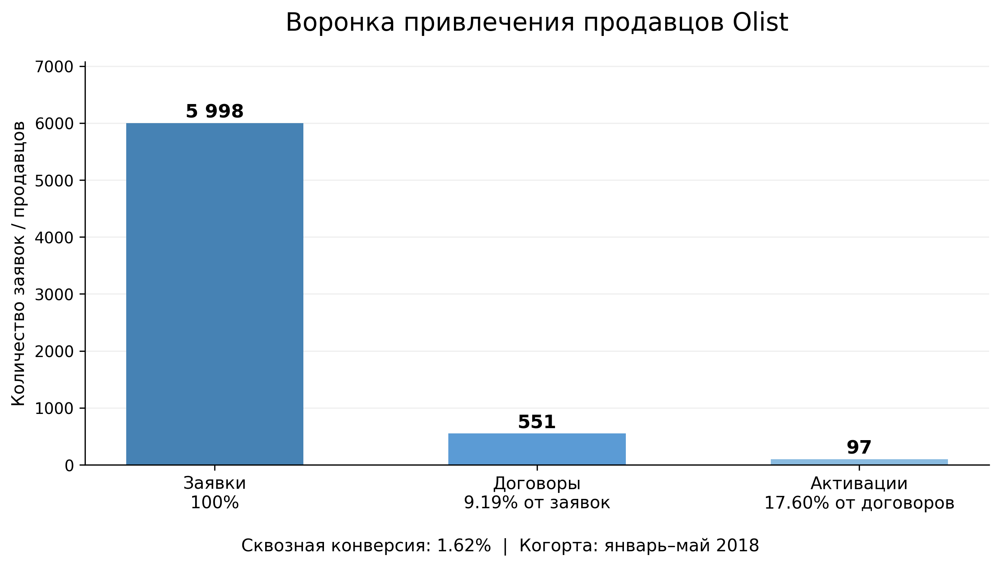
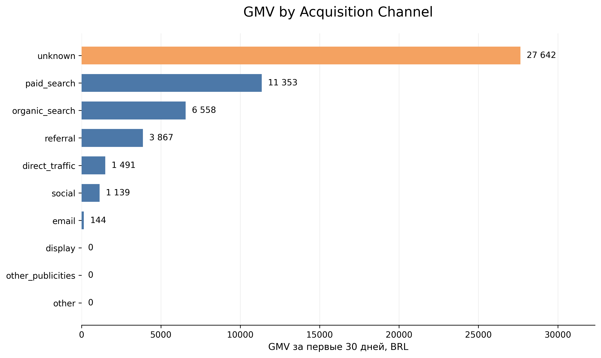
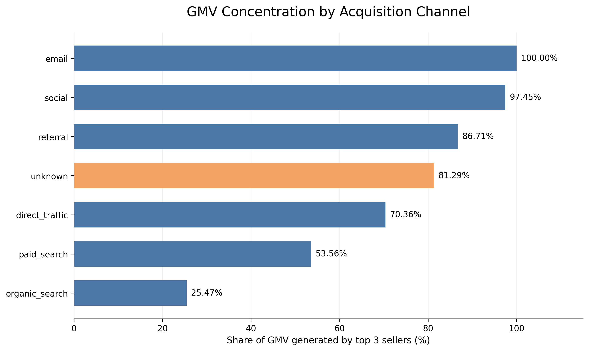

# Анализ эффективности каналов привлечения продавцов Olist

**Инструменты:** PostgreSQL, SQL, Python, pandas, matplotlib, statsmodels.

## 1. Бизнес-задача

Olist — бразильский маркетплейс, который привлекает продавцов через различные маркетинговые каналы.

Предположим, перед командой аналитики поставлена задача: **определить, какие каналы привлечения продавцов наиболее эффективны и на какие из них стоит обратить внимание при распределении маркетингового бюджета.**

При этом количество заявок само по себе не отражает эффективность канала. Важно, сколько привлечённых продавцов заключают договор, начинают продавать и какой оборот они обеспечивают.

**Цель исследования:** сравнить каналы по конверсии в активных продавцов и объёму продаж на одну первоначальную заявку.

## 2. Данные

Использованы два открытых датасета с Kaggle:

- [Marketing Funnel by Olist](https://www.kaggle.com/datasets/olistbr/marketing-funnel-olist) — заявки потенциальных продавцов, источники привлечения и заключённые договоры.
- [Brazilian E-Commerce Public Dataset by Olist](https://www.kaggle.com/datasets/olistbr/brazilian-ecommerce) — информация о заказах, продавцах и стоимости товаров.

Основные таблицы:

| Таблица | Содержание |
|---|---|
| `marketing_qualified_leads` | Заявки и каналы привлечения |
| `closed_deals` | Заключённые договоры и продавцы |
| `orders` | Заказы, даты и статусы |
| `order_items` | Товарные позиции, продавцы и цены |

Для анализа выбраны заявки **с января по май 2018 года**. Более ранние месяцы исключены из основного сравнения из-за крайне низкой наблюдаемой конверсии в договоры и особенностей временного покрытия данных.

## 3. Методология

### Воронка привлечения

Рассматриваются три этапа:

**Заявка → Договор → Активация продавца**

Для расчётов используются следующие определения:

- **Договор:** заключён в течение 30 дней после заявки.
- **Активация:** продавец получил хотя бы один заказ со статусом `delivered`, оформленный в течение 30 дней после договора.
- **GMV:** суммарная стоимость товарных позиций подходящих заказов (`SUM(price)`), без стоимости доставки.

### Выбор временного окна

Для расчёта конверсии заявок в договоры выбран период 30 дней с момента регистрации заявки.

Анализ распределения времени до заключения договора показал, что 65,9% всех зарегистрированных сделок с корректной последовательностью дат заключаются в течение первых 30 дней, а 76,8% — в течение 60 дней.

Таким образом, 30-дневный период охватывает большую часть заключённых договоров. Дополнительно рассчитана конверсия за 60 дней для сравнения результатов.

Для оценки активации продавцов также используется период 30 дней с момента заключения договора. Это позволяет сравнивать каналы по доле продавцов, начавших продажи в течение установленного срока.
## 4. Результаты анализа

### Воронка привлечения



| Показатель | Значение |
|---|---:|
| Заявки | 5 998 |
| Договоры за 30 дней | 551 |
| Конверсия в договор | 9,19% |
| Активированные продавцы | 97 |
| Активация после договора | 17,60% |
| Сквозная конверсия | **1,62%** |
| Общий GMV за первые 30 дней | **52 194 BRL** |

Таким образом, из 100 первоначальных заявок в среднем около 1,6 приводят к активации продавца по выбранному определению.

### Эффективность каналов

Для сравнения каналов использована метрика **GMV per Lead**:

`GMV per Lead = GMV канала / количество первоначальных заявок`

Она позволяет учитывать не только оборот, но и объём привлечённых заявок.



| Канал | Заявки | Активированные продавцы | GMV на заявку, BRL |
|---|---:|---:|---:|
| Unknown | 861 | 23 | 32,10 |
| Referral | 211 | 5 | 18,33 |
| Paid Search | 1 182 | 23 | 9,60 |
| Direct Traffic | 380 | 8 | 3,92 |
| Organic Search | 1 736 | 33 | 3,78 |
| Social | 1 051 | 4 | 1,08 |
| Email | 347 | 1 | 0,41 |

Каналы с нулевым GMV в таблицу не включены.

**Основные наблюдения:**

- **Paid Search** обеспечивает 9,60 BRL на заявку — примерно в 2,5 раза больше, чем Organic Search.
- **Organic Search** приводит больше всего активированных продавцов среди известных каналов — 33.
- **Social** привёл 1 051 заявку, однако активировались только 4 продавца.
- **Unknown** имеет наибольший GMV на заявку, но реальный источник этих заявок неизвестен.

### Влияние крупных продавцов

Дополнительно было проверено, насколько GMV каждого канала зависит от нескольких крупнейших продавцов. Для этого использовал оконную функцию `ROW_NUMBER()`.



| Канал | Доля GMV топ-3 продавцов |
|---|---:|
| Organic Search | 25,47% |
| Paid Search | 53,56% |
| Unknown | 81,29% |
| Referral | 86,71% |
| Social | 97,45% |

Высокий GMV на заявку не всегда означает устойчивую результативность канала.

Например, у Referral почти 87% оборота приходится всего на трёх продавцов. Organic Search, напротив, отличается более равномерным распределением GMV.

## 5. Выводы и рекомендации

**1. Paid Search стоит рассмотреть для дальнейшего тестирования.**

Канал показывает высокий GMV на заявку при сопоставимой с Organic Search сквозной конверсии. Однако перед увеличением бюджета необходимо оценить стоимость привлечения продавца.

**2. Organic Search — важный источник активных продавцов.**

Канал лидирует по количеству активаций и имеет относительно низкую концентрацию GMV. Имеет смысл продолжать работу над органическим привлечением.

**3. Для Social необходимо исследовать причины низкой конверсии.**

Большое количество заявок практически не преобразуется в активных продавцов. Стоит проверить качество аудитории, рекламные сообщения и этапы потерь в воронке.

**4. Необходимо улучшить атрибуцию маркетинговых каналов.**

На Unknown приходится около 53% общего GMV. Без корректного определения источников этих заявок оценка эффективности маркетинга остаётся неполной.

## 6. Ограничения анализа

- Нет данных о стоимости привлечения, комиссиях и прибыли. **GMV не равен выручке или прибыли Olist**, поэтому оценить ROI каналов невозможно.
- Анализ ограничен выбранной когортой и 30-дневными окнами. Продавцы могли начать продавать позже.
- Статус `delivered` используется как признак успешного заказа, а 30-дневное окно определяется датой его оформления, не доставки.
- Результаты некоторых каналов зависят от небольшого числа продавцов и крупных заказов.

## 7. Структура проекта

```text
├── SQL/
│   ├── 01_data_quality.sql
│   ├── 02_funnel.sql
│   ├── 03_activation.sql
│   └── 04_channel_performance.sql
├── SQL results/
├── notebooks/
│   ├── conversion_statistics.ipynb
│   └── visualizations.ipynb
├── figures/
│   ├── olist_funnel.png
│   ├── gmv_by_channel.png
│   └── gmv_concentration.png
└── README.md
```

SQL использовался для подготовки данных и расчёта метрик, Python — для статистического сравнения каналов и визуализации результатов.
